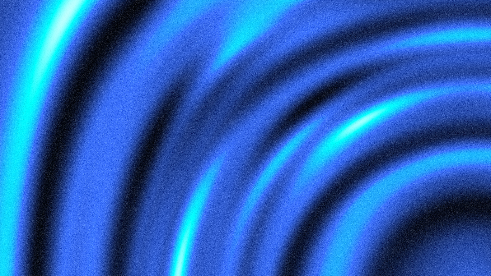
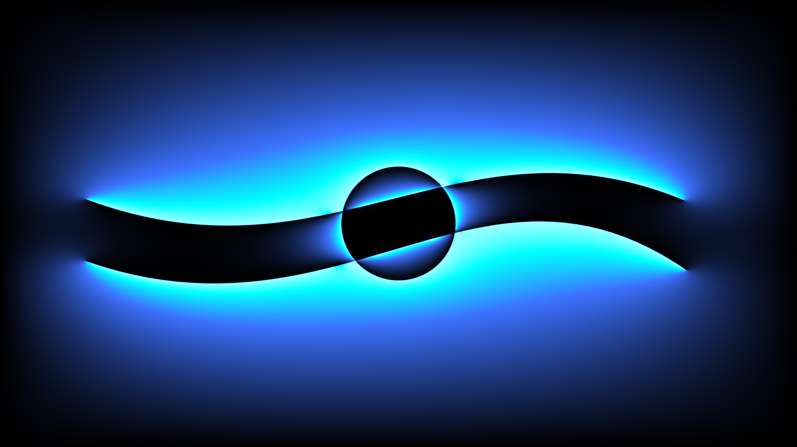
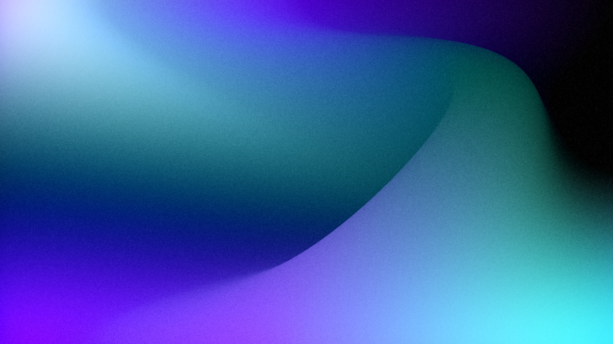

# Affinity Film Grain 2.0

**Free, editable film grain for Affinity 3.3+.**

Add natural-looking grain to photos, gradients and designs, with controls for size, strength, sharpness, color and tonal response. The grain sits on a separate layer and automatically fits the canvas or selected artboard.

**Run the script again to adjust your saved settings without starting over.**

Version 2.0 is a complete rewrite of the [original Film Grain macro](https://github.com/MaxsonRichards/affinity-film-grain), using a new grain generator.

**[Download v2.0.0](https://github.com/MaxsonRichards/affinity-film-grain-2/releases/tag/v2.0.0)** · [JavaScript source](MRFilmGrain.js) · [MIT license](LICENSE)

## Before and after

### Image 1

**Before**


**After**



### Image 2

**Before**



**After**


### Image 3

**Before**


**After**



## What's new compared with the macro?

| | Original macro | Film Grain 2.0 |
| --- | --- | --- |
| Installation | `.afmacros` | `.afscripts` |
| Grain mechanism | Live Procedural Texture using `noisei()` | Generated stochastic grain bitmap |
| Color | Offset RGB noise components | Continuous monochrome-to-independent-RGB control |
| Edge character | Defined by the noise function | Soft-to-crisp Sharpness control |
| Tonal response | Overlay compositing | Linear Light, black/white protection and Shadow Bias |
| Edit later | Open the live filter | Run the script again to reopen stored settings |
| Placement | Applied to a selected object | Separate grain layer fitted to the canvas or selected artboard |

## Features

- Adjustable grain size, variation and sharpness.
- Monochrome or colored grain.
- Controls to reduce grain near black and white, or favor shadows or highlights.
- Automatic sizing and separate grain settings for each artboard.
- Original artwork preserved beneath a separate **MR Film Grain** layer.
- Settings saved in the document for later editing.

## Requirements

**Affinity 3.3 or later with scripting enabled.** Tested on Windows with Affinity 3.3.1 in RGB documents. Other operating systems and color modes have not been fully tested. Affinity V2 is not supported.

## Installation

1. Download **`MR_FilmGrain_2.0.afscripts`** from the [v2.0.0 release](https://github.com/MaxsonRichards/affinity-film-grain-2/releases/tag/v2.0.0).
2. Open **Scripts Library** in Affinity and choose **Import Scripts…** from the panel menu.
3. Select the downloaded file and click **Open**.

On the first run, choose **Trust & Run**.

If you use [Affinity Script Manager](https://github.com/JiriKrblich/Affinity-script-manager), you can install `MRFilmGrain.js` with **Add Script → Save & install** instead.

## Usage and editing later

1. Open your project. In an artboard document, select the desired artboard or any layer inside it.
2. Run **MR Film Grain 2.0** from Scripts Library.
3. Adjust the controls and click **OK**. A layer named **MR Film Grain** is added above your artwork.
4. To edit the effect later, run the script again. Your previous settings will reopen.

In artboard documents, select an artboard or a layer inside it. If the script can't tell which artboard to use, it asks you to choose one. Documents without artboards use the current canvas.

You can also adjust the strength with the grain layer's opacity. Keep **MR Film Grain** inside its artboard, or at the top level in documents without artboards, so the script can find it on the next run.

After resizing a canvas or artboard, rerun the script to refit the grain. The previous grain layer is kept hidden if a replacement is needed. **Cancel** discards your edits; **Undo** can revert accepted changes.

## Controls

| Control | Variable | Default | Range | What it does |
| --- | --- | --- | --- | --- |
| Scale | `size` | **0.8** | 0.1–64 | Larger values produce larger grain. Very small values produce finer, weaker texture. |
| Grain variation (%) | `clump` | **50%** | 0–100% | Varies particle sizes and, at fine scales, how neighboring pixels relate. |
| Sharpness (%) | `sharpness` | **0%** | 0–100% | Soft grain edges at 0%; crisper texture at 100%. |
| Color (%) | `color` | **0%** | 0–100% | Monochrome at 0%; fully colored grain at 100%. |
| Seed | `seed` | **1** | 1–2,147,483,647 | Chooses a different pattern. The same seed and settings reproduce the same grain. |
| Amount (%) | `amount` | **30%** | 0–100% | Overall grain layer opacity. |
| Reduce grain in blacks and whites (%) | `tone` | **100%** | 0–100% | Fades grain near both tonal extremes while retaining it in midtones. At 0%, this extra protection is off. |
| Shadow bias (%) | `shadow` | **50%** | −100–100% | Positive values favor grain in shadows; negative values favor highlights; 0% is neutral. |

Compositing defaults to **Linear Light**. Shadow Bias still affects the distribution when black/white protection is at 0%.

Scale, Grain Variation, Sharpness and Seed changes generate a new texture. Amount and tonal adjustments reuse the existing texture. Large canvases and colored grain can take longer to update.

## How it works

For scales above 0.75, the script scatters signed grain particles at continuous random positions, with randomly varied radii and overlapping radial profiles. It samples these profiles at pixel centers, normalizes the resulting field, gently compresses outliers, and encodes the result around 50% gray in a 16-bit bitmap.

The particle profile uses `sharpness` from 0 to 1:

```text
q = max(0, 1 − distance² / radius²)
kernel = min(1, q / (1 − 0.9 × sharpness))²
grain field = sum of signed particle amplitudes × kernel
```

At scales of 0.75 and below, a filtered statistical approximation represents grain integrated into pixels. Smaller scales reduce neighboring-pixel correlation and amplitude; individual particles smaller than a pixel cannot be resolved.

The Color control blends the shared monochrome field `M` with independently seeded channel fields `Ri`:

```text
channel grain = ((1 − c) × M + c × Ri) / sqrt((1 − c)² + c²)
```

Here `c` is Color from 0 to 1, and all fields are centered around zero. The denominator approximately preserves per-channel strength as Color changes.

The texture is blended using **Linear Light**. Affinity's blend ranges reduce its contribution near black and white and shift the balance toward shadows or highlights. The generator is not modeled on a specific film stock.

## License

[MIT License](LICENSE). Free to use, modify and redistribute under its terms.

Independent community project; not affiliated with or endorsed by Affinity or Canva. Product names and trademarks belong to their respective owners.
