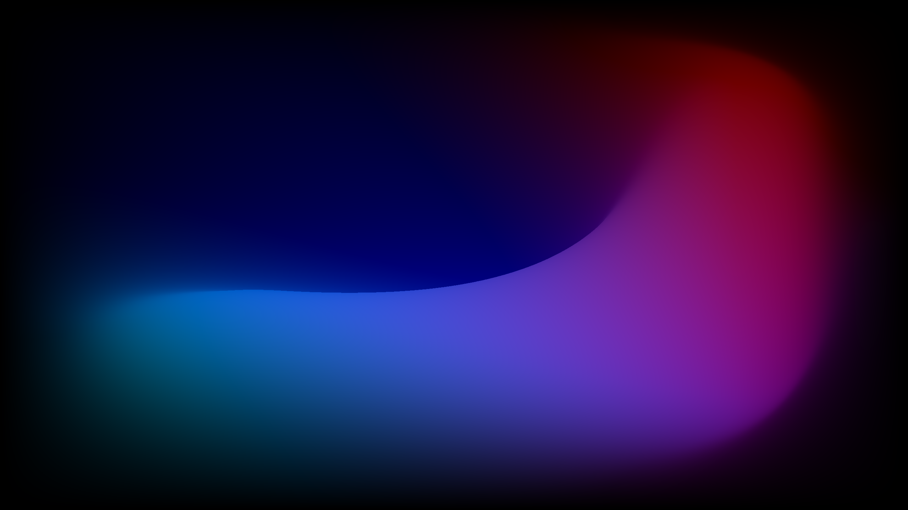
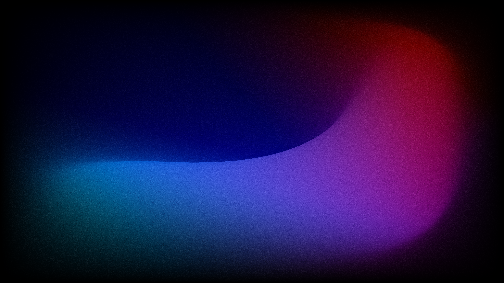
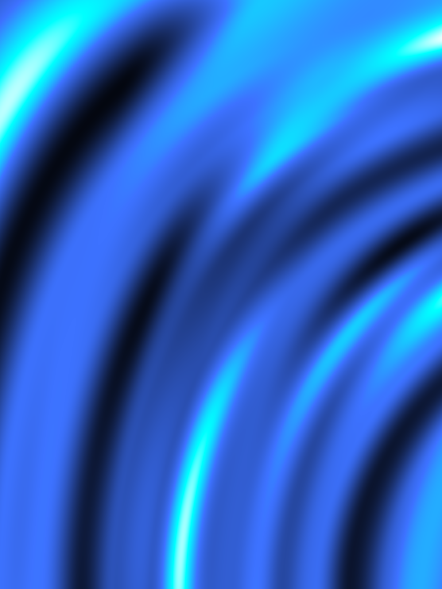
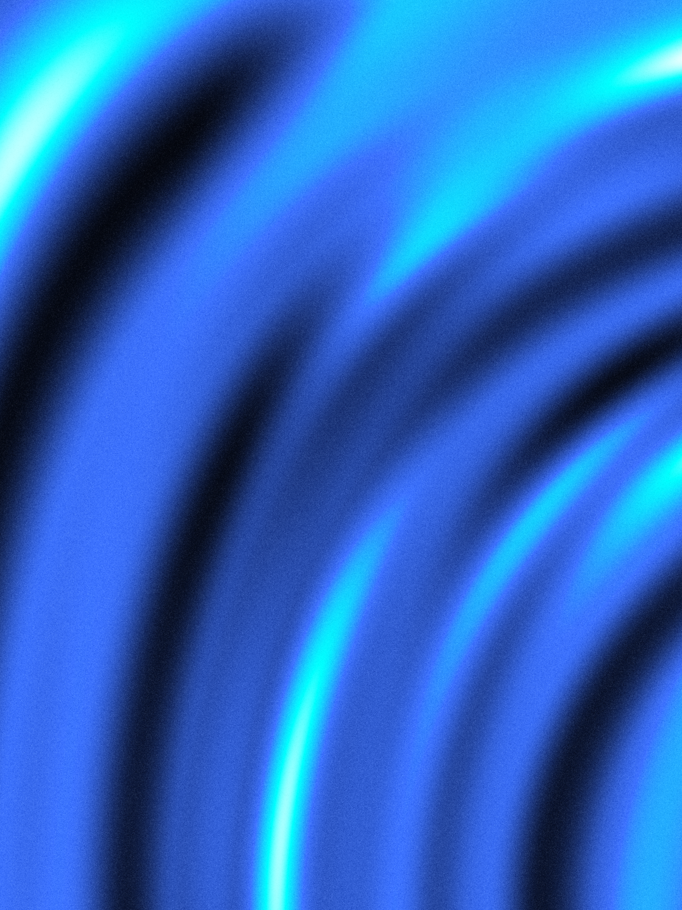
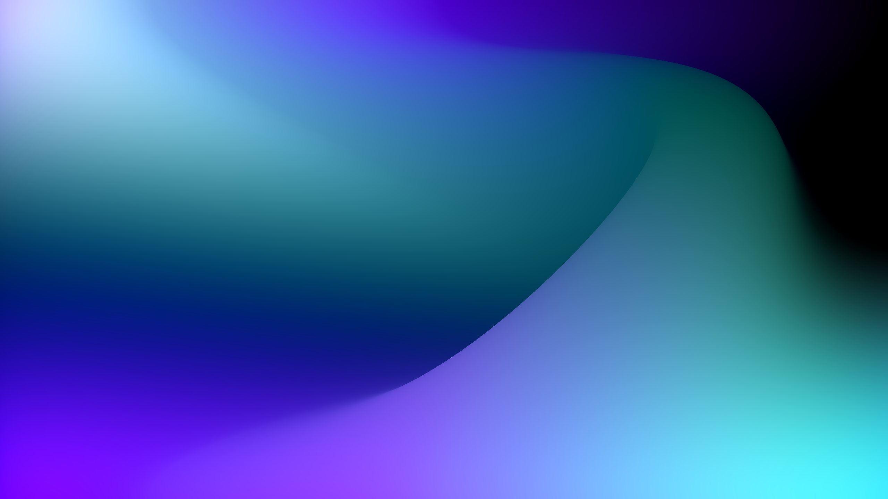
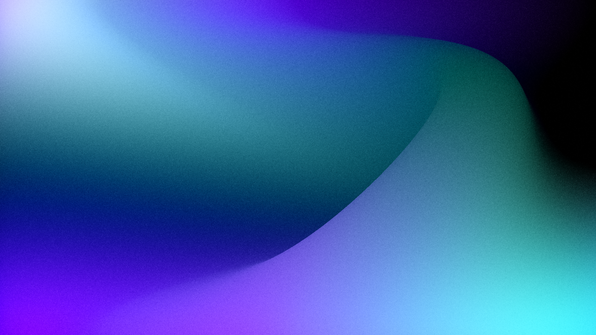

# Affinity Film Grain 2.0

**Free, editable film grain for Affinity 3.3+, completely rebuilt as a script for a more realistic, organic texture.**

This is the next generation of [Affinity Film Grain](https://github.com/MaxsonRichards/affinity-film-grain), the original Procedural Texture macro pack. Version 2.0 is a major rework: a new grain generator, a dedicated control window, adjustable softness and color, tonal protection, and automatic canvas/artboard sizing.

**Run the script again to edit your existing grain.** Your settings are stored in the document, so you can reopen the controls, change the values, and continue without starting over or rebuilding the effect.

**[Download v2.0.0](https://github.com/MaxsonRichards/affinity-film-grain-2/releases/tag/v2.0.0)** · [JavaScript source](MRFilmGrain.js) · [MIT license](LICENSE)

## Before and after

Three full-resolution comparisons are included below. Click an image to open its original PNG, then inspect at **100% zoom** to judge the grain. Small README thumbnails can hide fine texture. These examples illustrate the effect; they are not a matched comparison against the old macro.

| Example | Before | After |
| --- | --- | --- |
| 1 · 2560 × 1440 | [](images/Image1_Before.png) | [](images/Image1_After.png) |
| 2 · 1440 × 1920 | [](images/Image2_Before.png) | [](images/Image2_After.png) |
| 3 · 2560 × 1440 | [](images/Image3_Before.png) | [](images/Image3_After.png) |

## What's new compared with the macro?

| | Original macro | Film Grain 2.0 |
| --- | --- | --- |
| Installation | `.afmacros` macro library | JavaScript script |
| Grain mechanism | Live Procedural Texture using `noisei()` | Generated stochastic grain bitmap |
| Grain character | Noise fields combined in equations | Randomly positioned, overlapping particles with variable radii; a fine-scale statistical approximation |
| Color | Offset RGB noise components | Continuous monochrome-to-independent-RGB control |
| Edge character | Defined by the noise function | Soft-to-crisp Sharpness control |
| Tonal response | Overlay compositing | Linear Light, black/white protection and Shadow Bias |
| Edit later | Open the live filter | Run the script again to reopen stored settings |
| Placement | Applied to a selected object | Separate grain layer fitted to the canvas or selected artboard |

The new generator is designed to avoid the enlarged square-cell appearance of scaled grid noise and provide more control over the grain's shape and distribution. It is an artistic film-like approximation, not a calibrated simulation of a particular film stock.

## Features

- Fine, organic grain with adjustable Scale, Grain Variation and Sharpness.
- Fully monochrome grain by default, with optional color up to independent RGB grain.
- Adjustable strength and tonal response, including protection near pure black and white.
- Automatically matches the target's pixel dimensions and aspect ratio.
- Artboard support: select an artboard or a layer inside it; grain is placed at the top of that artboard.
- Independent grain settings for each artboard.
- Original artwork remains intact beneath a separate **MR Film Grain** layer.
- Settings persist in the document and reopen when you rerun the script.
- Generated grain remains embedded in the document after the script closes.
- No external textures, paid plugins, AI service or MCP connection required to use the script.

## Requirements

**Affinity 3.3 or later with scripting enabled.** Developed and tested on Windows with Affinity 3.3.1, primarily in RGB documents. Other operating systems and color modes have not been fully tested. This script is not compatible with Affinity V2's macro system.

## Installation

Download the .afscripts file and install through Affinity's Script Library window.

1. Download **`MR_FilmGrain_2.0.afscripts`** from the [v2.0.0 release](https://github.com/MaxsonRichards/affinity-film-grain-2/releases/tag/v2.0.0).
2. Open the Scripts Library window in Affinity and click 'Import Scripts...'.
3. Select the afscripts file and click 'open'. Done!

If you already use [Affinity Script Manager](https://github.com/JiriKrblich/Affinity-script-manager), its **Add Script** / **Save & install** workflow can install the `.js` source file instead. That optional third-party manager is not required.

## Usage and editing later

1. Open your project. In an artboard document, select the desired artboard or any layer inside it.
2. Run **MR Film Grain 2.0** from Scripts Library.
3. Adjust the controls and accept the dialog. The script creates **MR Film Grain** at the top of the target.
4. **To change the effect later, run the same script again.** It locates its existing grain layer and reloads the stored values. Keep that layer in the document so the script can find it.

In documents without artboards, the target is the current spread/canvas. With multiple artboards and no unambiguous artboard selection, an artboard chooser appears. Select the relevant artboard again when editing its grain.

This is editable by rerunning the script, rather than a continuously running live filter. Amount can also be adjusted through the grain layer's opacity. Keep the generated layer's normal placement and structure if you want the script to reuse it predictably.

After resizing the canvas or artboard, rerun the script to fit the new bounds. If the existing grain no longer fits, a correctly sized replacement is created and the old grain is retained hidden. Existing artwork is preserved. Cancel restores the prior effect; initial layer creation and subsequent changes are undoable.

## Controls

Percentages below are the values shown in the dialog. Corresponding internal variables use fractions, such as `0.3` for 30%.

| Control | Variable | Default | Range | What it does |
| --- | --- | --- | --- | --- |
| Scale | `size` | **0.8** | 0.1–64 | Grain scale in document pixels; below-pixel values become finer and weaker. |
| Grain variation (%) | `clump` | **50%** | 0–100% | Varies particle radii, or local correlation at fine scales. |
| Sharpness (%) | `sharpness` | **0%** | 0–100% | Soft grain edges at 0%; crisper texture at 100%. |
| Color (%) | `color` | **0%** | 0–100% | Shared monochrome grain at 0%; independent RGB fields at 100%. |
| Seed | `seed` | **1** | 1–2,147,483,647 | Changes the pattern reproducibly. |
| Amount (%) | `amount` | **30%** | 0–100% | Overall grain layer opacity. |
| Reduce grain in blacks and whites (%) | `tone` | **100%** | 0–100% | Fades grain near both tonal extremes while retaining it in midtones. At 0%, this extra protection is off. |
| Shadow bias (%) | `shadow` | **50%** | −100–100% | Positive values favor grain in shadows; negative values favor highlights; 0% is neutral. |

Compositing defaults to **Linear Light**. Shadow Bias still affects the distribution when black/white protection is at 0%.

**Changes to scale, variation, sharpness or seed will regenerate the texture. Amount and tonal controls reuse the cached grain.** Color fields are prepared on the first nonzero Color adjustment for a texture, then reused while editing that texture. Large documents and colored grain require more memory and processing time.

## How it works

For scales above 0.75, the script scatters signed grain particles at continuous random positions, with randomly varied radii and overlapping radial profiles. It samples these profiles at pixel centers, normalizes the resulting field, gently compresses outliers, and encodes the result around 50% gray in a 16-bit bitmap.

The particle profile can be summarized as:

```text
q = max(0, 1 − distance² / radius²)
kernel = min(1, q / (1 − 0.9 × sharpness))²
grain field = sum of signed particle amplitudes × kernel
```

At scales of 0.75 and below, a filtered statistical approximation represents grain integrated into pixels. Smaller scales reduce neighboring-pixel correlation and amplitude; individual particles smaller than a pixel cannot be resolved.

The Color control blends the shared monochrome field `M` with independently seeded channel fields `Ri`:

```text
channel grain = ((1 − c) × M + c × Ri) / sqrt((1 − c)² + c²)
```

Here `c` is Color from 0 to 1, and all fields are centered around zero. The denominator approximately preserves per-channel strength as Color changes.

Native underlying blend ranges then shape the grain's visibility across the image's tones. The script stores its settings on its own layer so a later run can reopen them. Documents without artboards use a pixel layer; artboards use a rectangle carrying the generated bitmap, clipped within the artboard. Both retain the same grain controls.

## License

[MIT License](LICENSE). Free to use, modify and redistribute under its terms.

Independent community project; not affiliated with or endorsed by Affinity or Canva. Product names and trademarks belong to their respective owners.
